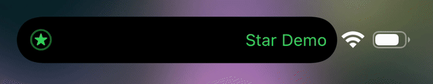

<p align="center">
  <a href="README.md">English</a> |
  <a href="docs/README_zh-Hans.md">简体中文</a>
</p>

# DuoStatusRing

When the Dynamic Island splits in two, DuoStatusRing folds the status bar's signal, Wi‑Fi and battery into a ring beside the bubble, and unfolds them when the island becomes one again.



## Install

Add the OwnGoal Studio repository in your preferred package manager:

**[apt.owngoal.dev](https://apt.owngoal.dev/)**

Packages are also on [GitHub Releases](https://github.com/owngoal-dev/DuoStatusRing/releases). Choose the one that matches your bootstrap.

| Installation | Package |
| --- | --- |
| [roothide](https://github.com/roothide) bootstrap | `iphoneos-arm64e` `.deb` |
| Rootless bootstrap (`/var/jb`) | `iphoneos-arm64` `.deb` |

Requires an iPhone with the Dynamic Island on iOS 16 or later. Developed and tested on iOS 26.6.2. There are no settings: install it and it works. To turn it off without removing it, create `/var/mobile/Library/wiki.qaq.duostatusring/disabled` inside the bootstrap and respring.

## What it does

- **Split.** The battery squeezes into a dot that grows into an arc over the top of the ring; the arc's fill is the battery level and its color follows the system battery (green while charging, yellow in Low Power Mode, red when low). The signal bars fall onto the ring and settle as four dots at its bottom opening. Wi‑Fi moves into the center.
- **Merge.** The arc retracts into its dot, the dots climb back into bars, the battery grows back out of the dot.
- **Interruptions** keep their momentum: an element moving one way turns around with the speed it has. Splitting and merging in quick succession never jumps.
- **Live data while folded.** A change in signal strength fades the dots and the Wi‑Fi bands; losing the connection draws a slash through the Wi‑Fi glyph; the battery level slides along the arc and colors crossfade.
- **The island stays Apple's.** DuoStatusRing only slows the split and merge springs to the pace of the design and lets the clock and icons follow the island's width changes with a slight bounce.
- The home screen, lock screen and apps all fold, since SpringBoard draws their status bars. Reduce Motion turns the morph into a crossfade. Landscape and Control Center's expanded status bar are left alone.

The Wi‑Fi glyph is drawn by hand in the system icon's proportions, with the ring's line weight. When there is no Wi‑Fi but cellular data, the network type sits in the center instead; with no connection at all, a slashed Wi‑Fi glyph does.

## How it works

DuoStatusRing runs in SpringBoard only. It follows the System Aperture's own layout reports and folds while two elements are visible side by side (native mitosis). The system's trailing icons stay where they are, hidden, and copies drawn from their live state morph into the ring, so the fold starts exactly where the icons are and ends exactly where they will be. Every part of the morph is a damped spring solved in closed form, so a late or skipped frame never desynchronizes anything, and one shared display link runs only while something moves.

## Building

DuoStatusRing builds with the plain Xcode toolchain; every step is a script under `scripts/`, so a local checkout and the Release workflow run the same bytes.

```sh
make check      # every static gate
make debs       # both packages, their dSYM archives and SHA256SUMS in build/pkg
```

`tests/host/run.sh` runs the timeline and geometry tests on a Mac. `tests/device/` holds the tools used to test on a virtual iPhone: a development-only dylib (runtime dumps, a per-frame recorder, an in-SpringBoard screen recorder and simulated radio data), never part of a package.

## Credits

Based on a design concept by Mobin.

## License

[MIT](LICENSE)
